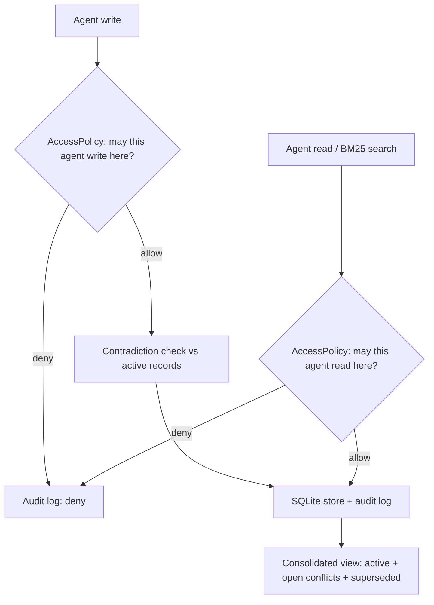

# Governed Shared Memory

> Multi-agent shared memory that can be trusted: per-agent private namespaces, one governed shared space, contradiction detection on write, provenance on every memory, and explicit supersession — so facts are never silently overwritten, leaked, or left stale.

**Author:** Amna Raheeba · Plain Python, runs fully offline with no API keys

---

## 1. Overview

### 1.1 The problem
Give several LLM agents one shared memory and four things go wrong (Caura et al., "Governed Shared Memory for Multi-Agent LLM Systems", arXiv:2606.24535, June 2026): one agent reads another's private notes (**unauthorized leakage**), an old fact keeps answering questions after it was corrected (**stale propagation**), two writers disagree and the newer write silently wins (**contradiction persistence**), and nobody can say where a fact came from (**provenance collapse**). Existing libraries — Mem0, Letta, Zep — are single-agent-first; the paper formalizes the failures in a production service, not a library.

### 1.2 The idea
A small, stdlib-only library where governance is the default, not a layer on top: every memory carries writer, timestamp, source and confidence from birth; private namespaces are owner-plus-admin only; writes are checked for contradictions against active records in the same namespace; and replacing a fact means an explicit, audit-logged supersession — the old record stays readable in history. Conflicts are surfaced, never silently resolved.

## 2. How It Works

### 2.1 Architecture



### 2.2 The four guarantees

| Failure mode | Where it is stopped |
|---|---|
| Unauthorized leakage | `access.py` — private namespaces are owner + admin only; denied reads are audit-logged as `deny` entries |
| Stale propagation | Reads and BM25 search return **active** records only; superseded records surface only via `history()` |
| Contradiction persistence | `contradictions.py` — every write is checked; conflicts stay open until resolved by explicit supersession |
| Provenance collapse | `records.py` — writer, timestamp, source, confidence are required fields; JSON export round-trips them |

### 2.3 Key concepts

- **Namespaces** — each agent owns a private namespace named after itself (`planner`, `researcher`); `shared` is the governed space every registered agent can read but only `writer`-role agents can write.
- **Contradiction-aware consolidation** — `consolidate()` returns the team's belief state as a view: active memories, open conflicts (both sides shown), and superseded memories with their replacement linked. Nothing is deleted or edited by consolidation; resolving a conflict means calling `supersede()`.
- **Two detectors** — *slot conflicts* (same subject + attribute, different date/money/number value — the case that matters most when agents overwrite each other's facts) and *polarity conflicts* (opposing negation vs positive-outcome markers over shared terms). Both are documented lexical heuristics adapted from the evidence-graph detector in [multi-agent-research-assistant](https://github.com/Amna-Raheeba/multi-agent-research-assistant); they catch blunt disagreement and miss paraphrases.
- **Search tie-break** — BM25 ties break toward the newest record, so when two writers disagree the reader sees the latest claim first, with the conflict flag next to it.
- **Audit log** — every write, read, supersession, denial and conflict is appended to SQLite and exported with the JSON dump.

## 3. Quick Start

```bash
# Python 3.10+, no dependencies for the library
python -m governed_shared_memory demo        # three-agent scenario
python -m governed_shared_memory evaluate    # eval task set

pip install pytest && pytest -q              # 67 tests
pip install streamlit && streamlit run dashboard/app.py   # live dashboard (see dashboard/README.md)
```

```python
from governed_shared_memory import Agent, GovernedMemory

mem = GovernedMemory("memory.db")
mem.register(Agent("planner", "writer"))
mem.register(Agent("researcher", "writer"))

record, conflicts = mem.write("planner", "project deadline is 12 January",
                              "shared", source="user")
record2, conflicts = mem.write("researcher", "project deadline is 20 January",
                               "shared", source="agent:planner")
# conflicts: 1 slot conflict — flagged, both records stay active

new = mem.supersede("planner", record.record_id,
                    "project deadline is 20 January", source="user")
# old record is now superseded; history(new.record_id) shows the chain
```

A full demo run is in [`examples/sample_session.md`](examples/sample_session.md).

## 4. Project Structure

```
governed_shared_memory/
├── records.py        # MemoryRecord + provenance · AuditEntry
├── access.py         # roles · private namespaces · governed shared space
├── contradictions.py # slot + polarity conflict detection on write
├── bm25.py           # pure-Python BM25 retrieval
├── store.py          # SQLite store + JSON export/import · audit log
├── memory.py         # GovernedMemory facade: write/read/search/supersede
├── consolidation.py  # contradiction-aware consolidated view
├── evaluation.py     # LongMemEval/LoCoMo-style task runner
└── __main__.py       # CLI: demo · evaluate · write · search · conflicts · consolidate
dashboard/            # Streamlit app: consolidated view, write, search, audit (dashboard/README.md)
data/eval_tasks.json  # 6 hand-written multi-session scenarios, 8 questions
notebooks/            # 01 demo scenario · 02 evaluation run
docs/experiment_log.md
results/              # demo_view.json · evaluation.csv, from real runs
tests/                # records · bm25 · contradictions · access · memory · consolidation · evaluation · dashboard
```

## 5. Design Decisions

| Decision | Why |
|---|---|
| Provenance as required fields | Optional metadata gets forgotten; required fields make provenance collapse impossible by construction |
| Conflicts flagged, never blocking | A disagreement between agents is evidence, not an error — blocking the write would lose the newer claim |
| SQLite + JSON, no server | One file, no deployment; JSON export keeps provenance portable between systems |
| BM25, not embeddings | Deterministic, offline, and fast at this scale; the retrieval path is the same code the evaluation measures |
| Supersession instead of update | An edit destroys history; a supersession link preserves exactly what changed and who changed it |

## 6. Evaluation

Hand-written LongMemEval/LoCoMo-style task set (`data/eval_tasks.json`): 6 multi-session scenarios, 8 questions, 2 planted cross-writer conflicts, 1 leak attempt. Measured by `python -m governed_shared_memory evaluate` (`results/evaluation.csv`):

| Metric | Result |
|---|---|
| Recall@5 | **1.00** (8/8) |
| Contradiction recall | **1.00** (2/2 planted conflicts flagged) |
| Leak blocked rate | **1.00** (1/1 unauthorized read denied) |
| Stale leak rate | **0.00** (no superseded record in any top-5) |

> Honest context: this is a small hand-written task set designed to exercise the guarantees, not a real benchmark — high scores are expected on scenarios built for the system. It is a regression harness: the value is that a future change which breaks a guarantee fails loudly here. The detectors are lexical heuristics and will miss paraphrased disagreement; the numbers say nothing about performance on real agent traffic.

## 7. Limitations & Roadmap

**Limitations:** contradiction detection needs shared terms and explicit markers, so paraphrased disagreement slips through · BM25 is lexical, so semantically similar facts with different words may not retrieve together · confidence is writer-reported, not calibrated · single-file SQLite, no concurrent multi-process writes · no embedding retrieval yet.

**Roadmap:** entailment-based contradiction detection behind the same interface · embedding retrieval as an optional scorer · confidence calibration from writer history · multi-process locking for the SQLite store · a real LongMemEval subset run against the same harness.

## License

MIT © 2026 Amna Raheeba — see [LICENSE](LICENSE).
